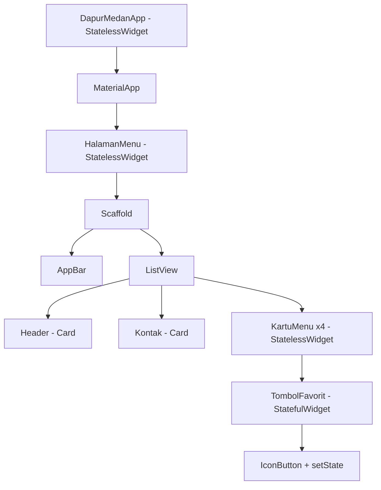
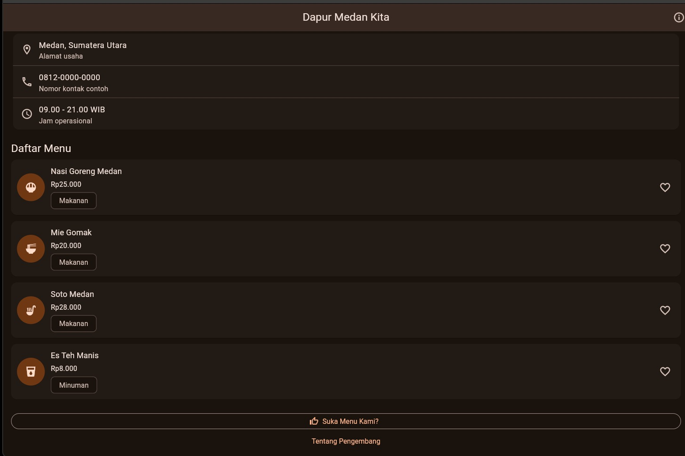
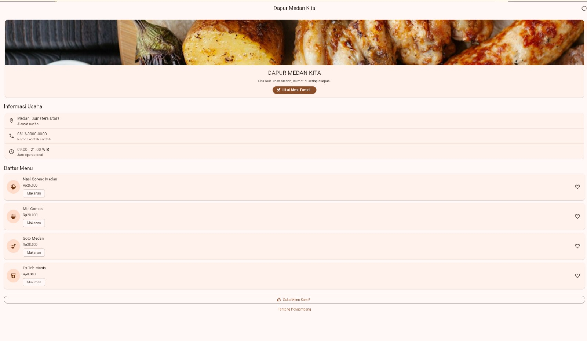
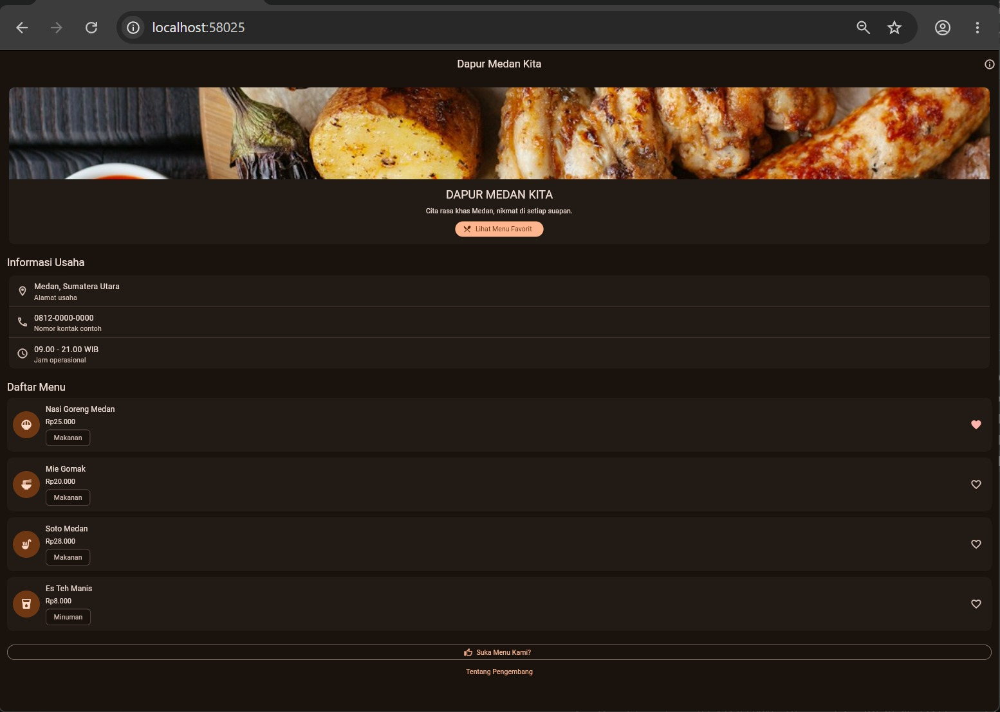

# Tugas Rutin Pemrograman Mobile - Pertemuan 5

## Identitas Mahasiswa

- **Nama:** Syuhada Simbolon
- **NIM:** 4243550016
- **Mata Kuliah:** Pemrograman Mobile
- **Pertemuan:** 5
- **Universitas:** Universitas Negeri Medan

## Judul Aplikasi

**Dapur Medan Kita - Aplikasi Menu UMKM Kuliner Medan**

## Deskripsi Aplikasi

Dapur Medan Kita merupakan aplikasi Flutter yang menampilkan informasi
usaha kuliner fiktif di Kota Medan.

Aplikasi ini menggunakan Material Design 3 dan menyediakan fitur:

1. Menampilkan nama, gambar, dan deskripsi usaha.
2. Menampilkan informasi kontak dan jam operasional.
3. Menampilkan empat menu makanan dan minuman.
4. Menandai atau membatalkan menu favorit.
5. Menampilkan SnackBar saat pengguna berinteraksi.
6. Mendukung tema terang dan gelap.

## Daftar Menu

| No. | Menu | Harga | Kategori |
|---|---|---|---|
| 1 | Nasi Goreng Medan | Rp25.000 | Makanan |
| 2 | Mie Gomak | Rp20.000 | Makanan |
| 3 | Soto Medan | Rp28.000 | Makanan |
| 4 | Es Teh Manis | Rp8.000 | Minuman |

## Diagram Widget Tree



## Penjelasan Widget Tree, Element Tree, dan Render Tree

Aplikasi Dapur Medan Kita menerapkan konsep widget tree, element tree,
dan render tree dalam membangun antarmuka Flutter. Widget tree
menggambarkan susunan komponen aplikasi, dimulai dari MaterialApp,
Scaffold, ListView, Card, hingga KartuMenu dan TombolFavorit.
Setiap widget memiliki tugas tertentu sehingga tampilan lebih
terstruktur dan mudah dipahami.

Element tree menghubungkan konfigurasi widget dengan elemen yang
dipertahankan Flutter selama aplikasi berjalan. Element juga
berperan dalam menyimpan State untuk StatefulWidget. Ketika
pengguna menekan tombol favorit, Flutter mempertahankan State
TombolFavorit selama posisi dan identitas widget tidak berubah.
Pemanggilan setState menandai bagian tersebut agar dibangun ulang
sehingga ikon hati dapat berubah tanpa perlu membangun ulang
seluruh halaman secara manual.

Render tree bertanggung jawab terhadap pengukuran ukuran,
pengaturan posisi, dan penggambaran komponen ke layar. Dengan
demikian, Card, teks, gambar, dan tombol dapat ditampilkan
sesuai tata letak yang ditentukan.

HalamanMenu dan KartuMenu dibuat sebagai StatelessWidget karena
keduanya hanya menampilkan data yang diterima dan tidak menyimpan
status interaksi yang berubah. Sebaliknya, TombolFavorit dibuat
sebagai StatefulWidget karena harus menyimpan nilai boolean
favorit. Pemisahan tersebut membuat pengelolaan state lebih
sederhana dan kode lebih mudah dirawat.

## Dokumentasi Pengujian

### 1. Tampilan Menu UMKM



### 2. Pengujian Tombol Favorit


### 3. Tampilan Mode Terang



### 4. Tampilan Mode Gelap



## Hasil Pengujian

Perintah pemeriksaan kode:

```powershell
flutter analyze
```

Hasil:

```text
No issues found!
```

Perintah pengujian otomatis:

```powershell
flutter test
```

Hasil:

```text
All tests passed!
```

Pengujian memastikan ikon favorit berubah ketika ditekan
dan dapat dikembalikan ke kondisi semula.

## Penggunaan AI

ChatGPT digunakan sebagai alat bantu dalam memahami materi Flutter,
menyusun contoh kode, menjelaskan penggunaan StatelessWidget dan
StatefulWidget, serta membantu pembuatan dokumentasi README.

Program dijalankan dan diuji menggunakan Visual Studio Code,
Flutter, dan Google Chrome.

## Pengembang

**Syuhada Simbolon - 4243550016**

Universitas Negeri Medan
